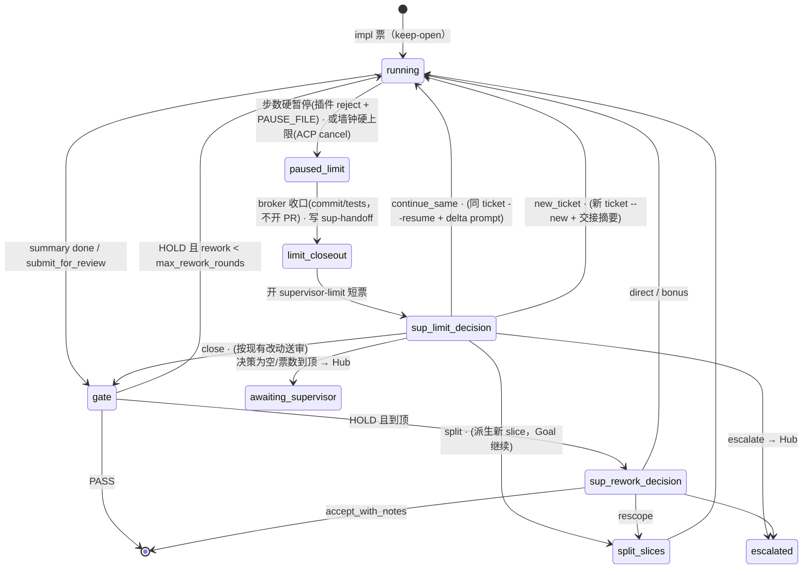

# dsh trial 编排对齐方案（监理 / 工头 / 审核员）· 2026-10-20

> 状态：**方案，未实现**。本文只读调研产出，未改任何代码/配置。
> 代码基线：本仓 `origin/main` = `ee420e7`（下文 `TB` = `broker/trial-broker.py`，`OS` = `open-slice.sh`，`TL` = `broker/trial_lib.py`，`TM` = `broker/trial_mailbox.py`，`AA` = `broker/dsh-acp-ask.py`——broker 实际调用的是仓内这份，见 TB:1343-1345；`~/.dsh/bin/dsh-acp-ask.py` 是旧副本，trial 链路不用）。
> box 配置：`LJ` = `~/.dsh/supervisor/trial/limits.json`，`CP` = `~/.dsh/profiles/acp-lite-trial/cordis.patch.yml`。
> dsh 核心：`@deepseek-ai/*@0.1.5-rc.2`，路径前缀 `~/.dsh/profiles/node_modules/@deepseek-ai/<pkg>/lib/index.js`（下文写作 `<pkg>:行`）。
> 完整调研底稿：box `/workspace/dsh-ops/orchestration-review-20261020/REPORT.md`。

---

## 1. 背景与对照原则

Pi 回归根因（`/workspace/pi-regression-20261020/ROOT-CAUSE.md` §6.2）之后，Runda 于 2026-10-20 15:56–15:58（UTC+8）给出编排原则，作为 dsh trial 底座的对齐目标：

| # | 原则 |
|---|---|
| P1 | token 节约不粗暴，效果效率优先；上下文到阈值**不强制交接**，靠压缩在原会话继续。 |
| P2 | 保留步数上限；工头/审核员到上限**暂停**，由监理判断：追加步数继续、复用还是新开、收尾还是升级。 |
| P3 | 审核放宽：只看增量；复审只核上轮未过项；小问题 PASS 附备注；环境类失败不算代码 HOLD；review 省 token。 |
| P4 | 不反复跑全量测试，监理/审核员统一编排集中跑。 |
| P5 | 同切片最多返工 2 轮，超过监理介入裁定（放行 / 定向指令 / 调整范围），监理处理不了才升级。 |

补充决定（Runda 16:17）：**做 G2**——撞上限后不结束 Goal，交监理五选一：原会话继续 / 新开票 / 收尾 / 拆分 / 升级（§5 单独成节）。

---

## 2. 现状（按 `ee420e7`）

### 2.1 暂停 / 交监理 / 复用

| 触发 | 现在的行为 | 证据 |
|---|---|---|
| 工头票中 `ask_supervisor` | 邮箱 watcher（仅 impl 票，2s 轮询）开 `supervisor-answer-*` 短票同步答复 | TB:2746-2747、2761-2784、1671-1759 |
| 工头 summary `question` | 自动监理答复 → reply pack → 下一轮**新** impl 票（max_rounds 自动 +1） | TB:6203-6257、4383-4438 |
| 工头 summary `blocked` | `awaiting_supervisor`，**不开监理票**，只发 Hub `dsh-trial-awaiting-hub` | TB:6183-6202 |
| 步数到预算 | 插件软提醒 2 次（impl 80/120），不停 | TL:164-165；TB:1369-1373；`plugins/dsh-step-budget-reminder/lib/index.js:101-132` |
| 墙钟硬上限（LJ `prompt_timeout_sec=1800`）或日志含 max_steps 字样 | `limit_stop_closeout`：有改动则 commit + 跑 pack 测试 + 按需 PR，写 `<slice>-sup-handoff-rN.md`；chain=`closeout`，**Goal=closeout 终态**，Hub「人工收口」；无改动 → failed | TB:5047-5055、5082-5093、5567-5694、6017-6079、6996-7012、8015-8024 |
| 空闲 900s | 普通 failed（非 limit） | TL:41；TB:5045-5046 |
| 上下文阈值 | 73k 压缩，原会话继续，无交接 ✅ | CP:130-134 |
| gate 撞上限/崩溃/无 summary | 不看 gate exit；解析默认 HOLD + 空 findings → 开空 fix 轮或进 max_rounds | TB:6348-6369、3399-3418 |
| chain 返工触顶 | park → 自动 `supervisor-maxrounds` 决策票：inplace(+1，仅 1 次)/split(只记录)/escalate | TB:6098-6150、6430-6517、4442-4795 |
| 票中 gate 轮数 `max_gate_rounds=2` | 指示工头写 blocked → 走 blocked → Hub | TB:2094-2132；TL:33 |
| 监理票数 `max_supervisor_tickets=8` | ask 路径直接 Goal=escalated | TB:1676-1699、4549-4556 |
| 会话复用 | 每轮新票名 + `--new` + `--final` | TB:5800、6270、2223、2719；OS:413-414 |

### 2.2 通信
- 文件桥 thin-state：packs / summaries / chains / goals（TB:131-134）。
- role-bridge 邮箱：只开 `ask_supervisor`、`submit_for_review` 两个封装，`send_to_role` 关（CP:111-121；TL:20-24；routes.json 两条路由；TM:13-31）。
- inbox job：`chain-reply`（TB:37-42、7395-7608）、`goal-update`（TB:74-79、8291）。无 CLI（`~/.dsh/bin/dsh-trial` 只有 status/report/limits）。
- 运行中的票无法被推送消息；gate/监理票无邮箱 watcher（TB:6358、4368）。

### 2.3 事件与通知
- dsh 监理 = broker 在事件点同步拉起的短票（TB:4345-4380）。broker inbox 空闲 20s 轮询、忙 0.05s tick（TB:8546、8958-8963、9038-9039）；watchdog 60s。
- Hub 通知（需 `notify:"hub"`，TB:1790-1792）：Goal complete/failed/limit（TB:8002-8033）、awaiting（TB:1849-1969）、watchdog 卡死/冻结（`broker/trial-watchdog.py:1-35、1411-1440`）；chain 级不发（TB:3542-3544）。
- 渠道：`khub-dsh-complete-notify.py` → Cursor automation webhook（routine「dsh 完成通知」）。最后一次真实发送 10-14 18:40（UTC+8，HTTP 200），10-15 起均 dry_run。
- max_rounds 决策路径（`fc7b09b`，10-14）生产零样本：无 `*-sup-maxrounds-*` summary，chain 无 `supervisor_decision`。

---

## 3. 局限归因：dsh 核心 vs 编排层

### 3.1 结论

| 能力 | dsh 核心是否支持 | 现状缺口在哪 | 推荐处理（优先 broker/插件层，不改核心） |
|---|---|---|---|
| (a) 工具调用拦截 / 步数硬暂停 | **支持**。`agent/pre-step` 是 waterfall，返回 `{kind:"reject"}` 即结束本 turn（`turnEnds={kind:"blocked"}`）：dsh-agent-loop:894-901、941-943；`tools/pre-execute` 可返回 `deny`+reason：dsh-tools:3116、3127；`tools/post-execute` 可 `block`/附 `additionalContexts`：dsh-tools:3378-3380（现成用法见 step-budget 插件 lib/index.js:101-132） | **编排层**：插件只提醒不拒绝；broker 无暂停状态 | 扩展 `dsh-step-budget-reminder`：到 `budget×step_hard_factor` 时 pre-step reject，并写暂停标记文件（见下一行原因）；broker 识别标记 → `paused_limit` |
| (a′) ACP 层区分「被拒停」与「正常完成」 | **核心限制**：ACP 把 `blocked`/`error`/`aborted` 都映射成 `end_turn`（dsh-acp:541-548） | — | 不改核心：插件写 `$DSH_PAUSE_FILE`（JSON），broker 以文件为准 |
| (a″) ACP cancel 优雅中止 | **支持**：`session/cancel` notification（dsh-acp:1312-1313、1322）→ `cancel()` 取消在途 prompt（dsh-acp:867-871、993-996），prompt 以 stopReason `cancelled` 返回（dsh-acp:544、1010、1022） | **编排层**：AA 没有实现 `session/cancel`（全文无此方法）；硬上限时直接抛异常 → `close_proc()` terminate（AA:513-536、553-559、856-858），既不 cancel 也不 close | AA 增加 `session_cancel()`；硬上限/暂停时 cancel → 等 prompt 返回（宽限 N 秒）→ `session/close` 刷盘 → 保留 ticket 元数据 → 专用退出码 |
| (b) 已关闭会话能否 resume | **支持（读码结论，未实测）**：`close()` = 取消 + 等空闲 + `ctx.sessions.flush` + dispose，不删持久化（dsh-acp:947-986）；`resumeSession` 只读持久化 header，要求非 subagent、cwd 一致、当前未激活（dsh-acp:1207-1214）。AA 的 `--close` 分支本身就是「新进程 resume 一个非激活会话再关」（AA:700-726） | **编排层**：`--final` 关闭后 `_clear_ticket` 删了 sessionId 映射（AA:851-855、188-192），sessionId 只剩日志里的 `sessionId=`（AA:824-825）；持久化在**角色/槽位 home** 下，resume 必须同一 home + 同 cwd | impl 票改 keep-open（保留元数据）；元数据已含 `dshHome`/`cwd`/`profile`（AA:827-839），broker resume 时钉回同一 home |
| (c) 给运行中会话推消息 | **ACP 层不支持排队**：会话已有在途 prompt 时第二个 `session/prompt` 直接报错（dsh-acp:797）。**核心 Agent 支持**：inbox `next-step` 与 `steer()/inject()`（dsh-agent-loop:22-31、783-797），但 ACP bridge 没暴露 | **核心（ACP）限制 + 编排层未用插件绕过** | 插件层：在 `tools/post-execute` 读 trial 邮箱 `steer/<ticket>/*.json`，把监理消息作为 `additionalContexts` 附到下一步（与 step-budget 同一模式，不破坏缓存前缀）；`agent.inject()` 作备选（消息结构需实测） |
| 上下文到阈值不交接 | 支持（compaction-basic） | 已符合 ✅ | 保持 |
| 审核分级 / 增量 / env_blocked / 测试编排 / 返工计数 / 决策选项 / 通知 | 与核心无关 | **全部是编排层**（broker + prompt + limits） | §4 |

**一句话**：真正属于 dsh 核心的限制只有两条——ACP 的 stopReason 把「被拒停」压成 `end_turn`，以及 ACP 不允许给在途 prompt 排队。两条都能在插件 + broker 层绕过（标记文件、post-execute 注入）。其余（硬暂停、cancel、关闭后 resume、监理决策、审核规则、测试编排）都是我们 trial 编排层没实现，不需要改核心。

### 3.2 风险点（读码发现）
- AA resume 失败时会回退到「该 cwd 最近一个会话」（AA:806-818）。同 cwd 多切片或多角色时可能接错会话。broker 发起「继续」时必须加 strict 模式，禁止这个回退。
- 槽位分配取最小空槽（TB:8807-8812）。Goal 重新进来时 slot 可能变了，而会话持久化在 `trial-slots/slot-N/<role>`，所以 resume 必须按元数据 `dshHome` 钉回原槽位 home，不能按新 slot 重算。

---

## 4. 差距清单与设计（G1–G14）

| # | 原则 | 差距 | 设计要点 | 量 | 风险 | 验证 |
|---|---|---|---|---|---|---|
| G1 | P2 | 无硬步数暂停 | 插件新增 `hardFactor`（默认 2.0）：`steps ≥ budget×hardFactor` → pre-step reject；reject 前写 `$DSH_PAUSE_FILE`=`{kind:"step_hard",steps,budget,at}`；在 `budget×1.5` 提醒里提示「到 2× 会暂停，先写 summary」 | 中 | 中 | 插件单测 + scratch 票（budget=5）看 turn/end reason=blocked、标记文件、broker 路由 |
| G2 | P2 | 撞上限 Goal 直接 closeout 终态 | 新状态 `paused_limit` + `supervisor-limit` 决策短票五选一（§5） | 中 | 中 | §5.8 |
| G3 | P2 | 不能复用会话 | impl 票 keep-open + cancel/close + strict resume（§5） | 大 | 中高 | §5.8 |
| G4 | P5 | ① `max_rounds=2` 是总轮数，1 轮返工就触顶（TB:5797-5798；LJ:4）；② 两套计数（`max_gate_rounds` vs `max_rounds`）；③ 缺放行/定向指令/调范围，split 只记录（TB:4744-4775）；④ inplace 仅 1 次，二次强制 escalate（TB:4598-4603、7442-7443） | ① `max_rounds=3`；② goal 内按切片统一 `rework_by_slice[slice]`，HOLD 不论来源 +1，上限 `max_rework_rounds=2`；③ 决策扩展为 `accept_with_notes`（仅剩 P1/P2 可用，P0 禁止；写进 summary + PR body）/ `direct`（带 `instruction`，注入 fix pack 顶部）/ `rescope`（改 acceptance 或给出新 slice 列表，broker 自动续 Goal）/ `escalate`；④ 改为 `max_round_bonus_total=2` | ①小 ②③④中 | accept 等于绕过 gate，需要留痕 | 单测：决策解析和状态迁移；scratch 票故意连续 HOLD |
| G5 | P5 | blocked 不叫监理 | blocked 同 question 走 `auto_supervisor_answer`；监理可答复、调范围或升级；`max_gate_rounds` 到顶也进监理决策 | 小 | 小 | 单测 + 一张 blocked 演练票 |
| G6 | P3 | P2-only 时 gate 写 HOLD 仍保留 HOLD（TB:3462-3466）；缺测一律 P1（OS:240）；文案没有定档 | `enforce_gate_verdict`：无 P0/P1、无 unmet → 强制 PASS，并记 `pass_with_notes=true`；prompt 写明文案/措辞/证据格式 = P2；缺测仅在 acceptance 要求时算 P1 | 小 | 小到中 | 单测 + 回放历史 22 条 FAIL |
| G7 | P3 | chain r≥2 用全量 `build_gate_pack`，不带上轮 findings（TB:6309-6318、2947-2952）；delta 复审允许新 P1（TB:2623） | chain r≥2 改用 `build_delta_gate_pack(prior_findings, base_sha=last_reviewed_sha)`；复审新发现只有 P0 能 HOLD，新 P1/P2 进 notes | 小到中 | 小 | 单测：pack 内容 |
| G8 | P3 | 没有 env_blocked；gate 崩溃 = 空 HOLD（TB:3399-3418、2283-2287；TL:472-488） | verdict 增 `ENV_BLOCKED`（findings `tier:"ENV"`）；gate exit≠0 或无 summary → `gate_error`；两者都**不计轮次**，重跑 gate `env_blocked_retry=1` 次，仍失败则 Hub `dsh-trial-env-blocked`，不退回工头 | 中 | 小到中 | 注入失败的 gate（假 summary / exit 1） |
| G9 | P4 | 无测试编排；prompt 无测试策略；仅 closeout 跑 pack 测试（TB:5628-5629） | pack frontmatter `tests: [...]`；工头只跑定点；broker 在 gate 前按 `_impl_fingerprint`（TB:2449）集中跑一次并缓存到 `thin-state/tests/<slice>-<fp>.json`，路径写进 gate pack；gate prompt「不跑测试，只读结果」 | 中 | 小 | 一张带 tests 的票，确认只跑一次 |
| G10 | P3 | gate 推理 high（LJ:13-17），复审同 high | `reasoning_effort_by_kind`：`gate_first=high`、`gate_delta=low` | 小 | 质量 | 对比复审 token 与 FAIL 率 |
| G11 | P5 | 监理票上限 8 → 直接 escalate | `max_supervisor_tickets=14`，或决策票单独计 `max_decision_tickets` | 小 | 小 | — |
| G12 | — | 通知全是 dry_run；无回执 | 正式 Goal `notify_dry_run:false`；通知日志记录响应；可选 Hub 回写 ack | 小 | 小 | 发 1 条真实 awaiting |
| G13 | — | `dsh-trial-supervisor` SKILL:41、64 过时 | 更新 skill（max_rounds 决策、chain 不发通知、新 limit 决策） | 小 | 无 | — |
| G14 | — | max_rounds 决策零样本 | scratch 票演练 | 小 | 小 | 用独立 cwd，避免与其他 Goal 串行冲突 |

### 4.1 新配置项（`limits.json`，均有默认，可经 `goal-update` 覆盖）

```json
{
  "max_rounds": 3,
  "max_rework_rounds": 2,
  "max_round_bonus_total": 2,
  "max_supervisor_tickets": 14,
  "step_budget_by_role": {"supervisor": 30, "impl": 80, "gate": 60},
  "step_hard_factor": 2.0,
  "limit_pause_enabled": true,
  "impl_session_mode": "final",
  "continue_same_max": 2,
  "continue_step_grant": 40,
  "continue_time_grant_sec": 1200,
  "acp_cancel_grace_sec": 60,
  "resume_max_last_peak_prompt": 90000,
  "resume_max_total_steps": 240,
  "env_blocked_retry": 1,
  "reasoning_effort_by_kind": {"gate_first": "high", "gate_delta": "low"}
}
```
注：`trial_lib.save_global_limits` 只写 `DEFAULT_LIMITS` 键（`02d06e0` 正在修，保留 role 表）。新键必须同时加入 `DEFAULT_LIMITS` 或保留列表。

---

## 5. G2/G3 专节：撞上限 → 监理五选一（含「原会话继续」落地方案）

### 5.1 目标
工头撞上限（步数硬暂停 / 墙钟硬上限）后：**不结束 Goal、不丢会话**，由 dsh 监理短票五选一：
`continue_same`（原会话继续）/ `new_ticket`（新开票带交接）/ `close`（收尾）/ `split`（拆分）/ `escalate`（升级）。只有 `escalate`（或监理决策失败）才通知 Hub。

### 5.2 状态流



要点：`paused_limit` 和 `limit_closeout` 是 **chain 状态**，Goal 保持 `running`、`awaiting_reason="limit_pause"`（不进 `_CHAIN_TERMINAL_STATES`，TB:3894）。watchdog 的 `goal_no_ticket` 要把这两个状态当「决策中」，不报 stall。

### 5.3 impl 票改 keep-open（第三批启用，开关 `impl_session_mode`）
- `run_open_slice`：impl 角色在 `impl_session_mode="keep_open"` 时传 `--keep-open` 而不是 `--final`（现在固定 `--final`，TB:2719）。gate、监理仍用 `--final`。
- open-slice：keep-open 时仍首轮 `--new`（OS:414 不变）；新增 `--resume-ticket` 分支：传 `--resume --strict-resume` 并带 delta prompt。
- 票元数据：AA 已写 `<DSH_HOME>/acp-tickets/<ticket>.json`，内容 `{sessionId,cwd,mcpServers,ticket,role,dshHome,profile,updatedAt}`（AA:164-192、827-839），其中 `DSH_HOME` 为槽位角色 home（TB:1348-1354）。broker 在 chain round 记录里再存一份 `session_ref = {ticket, session_id, dsh_home, slot, cwd, profile}`，防止元数据被误删。
- 正常 PASS / 收尾 / 升级之后，broker 统一 `AA --ticket X --close`（AA:700-726）。chain 结束时清理所有 keep-open 票，避免会话泄漏。

### 5.4 撞上限时如何中止（优先 ACP cancel）
已核实：ACP 支持 `session/cancel` notification（dsh-acp:1312-1313、1322）。在途 prompt 被取消后以 `stopReason:"cancelled"` 返回（dsh-acp:867-871、1010、1022）。AA **目前未实现** cancel，硬上限只抛异常 + terminate（AA:513-536、553-559、856-858）。

改法（AA，第三批前置）：
1. 新增 `session_cancel(sid)`，发 notification `{"method":"session/cancel","params":{"sessionId":sid}}`。
2. `wait_for` 撞 hard cap 时：先 cancel，再在 `acp_cancel_grace_sec` 内等原 prompt 的 response（应为 cancelled）。等到了就 `session_close(sid)` 刷盘（dsh-acp:947-986 里有 `ctx.sessions.flush`）。超时才 terminate。
3. keep-open 模式下 close 之后**不调** `_clear_ticket`（保留 sessionId），stderr 打 `LIMIT_PAUSED kind=hard_cap sessionId=<sid>`，退出码 `75`（EX_TEMPFAIL），与普通失败区分。
4. 步数硬暂停是插件 pre-step reject：prompt 正常以 `end_turn` 返回（dsh-acp:545-546），AA 照常结束。broker 通过 `$DSH_PAUSE_FILE`（`ARTIFACT_ROOT/offload/<ticket>/paused.json`，env 由 `_spawn_env` 注入）判定为暂停。
5. broker：`limit_stop_kind` 增加两个来源，退出码 75 和 PAUSE_FILE 存在，优先于日志正则（TB:5047-5055）。
6. 不杀进程树。watchdog 的 session_idle 杀进程（`trial-watchdog.py:37-41`）仍是最后兜底。

**中止后会话是否完整落盘**：走 cancel → close 路径时，核心会 drain 并 flush（dsh-acp:952-972），读码判断完整。直接 terminate 时（现状）是否丢最后一个 step 未知，列入验证清单 V2/V3。

### 5.5 broker 收口与交接
沿用 `limit_stop_closeout`（TB:5567-5694），改三点：
- **不开 PR**，也不把结果叫 `closeout` 终态；chain=`limit_closeout`。
- 交接文件仍写 `<slice>-sup-handoff-r<N>.md`，machine block 增加 `session_ref`、`steps`、`last_peak_prompt`、`compactions`（来自 composition，TB:3274 `_peak_prompt`）、`resume_eligible` 及原因。
- commit 照旧（保护分支和分支不匹配时拒绝的逻辑保留，TB:5616-5621）。commit 之后原会话 resume 时工作区已干净，delta prompt 里要告诉工头「已提交 <sha>」。

### 5.6 监理决策票 `supervisor-limit-<slice>-r<N>`
- 输入 pack（≤4KB）：交接文件路径 + machine block 摘要、未完成项、`resume_eligible`、剩余 `continue_same` 次数、选项说明。
- 输出 summary `<slice>-sup-limit-r<N>.md`，machine block：

```json
{
  "action": "limit_decision",
  "slice": "<slice>",
  "decision": "continue_same|new_ticket|close|split|escalate",
  "grant_steps": 40,
  "grant_time_sec": 1200,
  "instruction": "监理定向指令（≤800 字）",
  "split": [{"slice": "<id>", "pack": "<name>.pack.md", "acceptance": ["…"]}],
  "notes": "一句理由"
}
```
- broker 校验：
  - `continue_same` 要求 `resume_eligible=true` 且 `continue_count < continue_same_max`，否则降级为 `new_ticket` 并记原因。
  - `split` 必须带非空 `split`。
  - 解析失败 → `awaiting_supervisor` + Hub（现有 `_notify_awaiting_hub`，TB:1852）。
- `chain-reply` 支持同一 decision 结构（人或 Hub 也可以直接拍板）。

### 5.7 五个选项的执行
| 决策 | broker 动作 |
|---|---|
| `continue_same` | 同 ticket：`AA --ticket <原 ticket> --resume --strict-resume --prompt <delta>`。env 钉 `DSH_HOMES_ROOT/DSH_HOME = session_ref.dsh_home`，cwd 用 `session_ref.cwd`；step budget 设为 `已用步数 + grant_steps`（插件计数器在新进程会从 0 开始，所以由 broker 传 `DSH_STEP_BUDGET=grant_steps`）；`DSH_ACP_PROMPT_TIMEOUT=grant_time_sec`。delta prompt 模板：「继续本票。已提交 <sha>；剩余：<未完成项>；监理指令：<instruction>；追加步数 <N>；完成后按原格式写 summary（路径不变）并 submit_for_review。」round 号不变，记 `continue_count+1` |
| `new_ticket` | 新 ticket `impl-trial-<slice>-r<N>c<k>`，`--new`。pack = 原 pack + 交接摘要（handoff machine block + 监理 instruction，≤2KB）。旧票 `--close` |
| `close` | 旧票 `--close`；不再开 impl，直接用当前 HEAD 开 gate（走正常 gate 路径，含 G7/G8） |
| `split` | 旧票 `--close`；当前切片按已提交内容送 gate（或标 `partial`），`split` 列表写进 goal 的 slice specs，并追加在 `_execute_goal_slices` 后续执行（TB:6827）；受 `max_slices` 约束 |
| `escalate` | 旧票 `--close`；chain=`escalated`；Hub `dsh-trial-goal-failed`（现有 TB:8025-8033） |

### 5.8 会话体积门槛与压缩
- 压缩线：`thresholdRatio 0.07 × 1,048,576 ≈ 73k` 触发，保留约 26k（CP:130-134）。resume 恢复的是**持久化后的投影**（含压缩结果），所以续跑首个请求预计在「保留尾 + delta」量级，而不是全历史。需实测（V5）。
- `resume_eligible` 判定（broker 从 composition / 会话统计取值）：`last_peak_prompt ≤ resume_max_last_peak_prompt`（默认 90k，留出压缩不及时的余量）、`steps_total ≤ resume_max_total_steps`、`continue_count < continue_same_max`、会话文件存在于 `session_ref.dsh_home/sessions`。任一不满足 → 建议 `new_ticket`。
- 和 P1 的关系：上下文本身不是交接理由（压缩兜底）。门槛只防「同一会话反复续跑、步数无限累积」。

### 5.9 box 重建后会话是否还在
- `~/.dsh-homes` → `/workspace/persist/.dsh-homes`（软链，2026-10-20 15:27 迁移）。槽位 home 为 `~/.dsh-homes/trial-slots/slot-N/{impl,gate,supervisor}`，其中 `sessions/`、`acp-tickets/` 都在 persist 下。`~/.dsh` 同样迁到 `/workspace/persist/.dsh`。
- 前提是 `/workspace/persist` 能跨实例保留（迁移计划 `/workspace/box-persistence-audit-20261020/PLAN.md`），需实测（V8）。
- 进行中的 prompt 在冻结/换实例时没有 cancel 机会。恢复后 broker 的 T2 resume（TB:5821-5858）应先尝试 `--resume` 同 ticket；失败再按现逻辑重开。

### 5.10 验证清单（第三批启用前逐项过；只在 scratch 票 + 独立 cwd 上做）
| # | 待实测 | 通过标准 |
|---|---|---|
| V1 | pre-step reject 在 ACP 下的表现 | prompt 返回 `end_turn`；会话 turn/end reason=blocked；PAUSE_FILE 已写；进程正常退出 |
| V2 | `session/cancel` 中止在途 prompt | 宽限内返回 `stopReason=cancelled`；随后 `session/close` 成功 |
| V3 | cancel+close 后落盘完整性 | resume 后会话包含最后一个完成 step，无半截工具调用 |
| V4 | `--final` 关闭后的会话能否 `--resume`（用日志里的 sessionId 手工写元数据） | resume 成功，cwd 一致，新 prompt 能看到历史 |
| V5 | 压缩后 resume 的首请求 prompt 大小与缓存命中 | 首请求 ≈ 保留尾 + delta；记录 cache 命中 |
| V6 | strict resume：resume 失败时不回退到「最近会话」 | 失败即报错，退出码可区分 |
| V7 | 跨槽位：Goal 换 slot 后按 `session_ref.dsh_home` resume | 成功；不在新槽位 home 下误开新会话 |
| V8 | box 重建/换实例后 `/workspace/persist/.dsh-homes` 会话仍在 | `session/list` 能列出，resume 成功 |
| V9 | 续跑时步数预算 | 新进程计数从 0 起，`grant_steps` 生效 |
| V10 | keep-open 票清理 | chain 终态后无残留 acp-tickets；GC 不误删在用会话 |
| V11 | watchdog 与 `paused_limit`/`limit_closeout` | 不报 goal_no_ticket stall；session_idle 不误杀 |

---

## 6. 分批实施计划

**第一批（小改，1–2 张 acp-lite-trial 小票，不动状态机主干）**
- G4①（`max_rounds=3`）、G5（blocked → 监理）、G6（PASS-with-notes 强制）、G7（chain r≥2 delta gate）、G10、G11、G12、G13。
- 验证：单测 + 回放历史 FAIL + 一张 blocked 演练票。

**第二批（中，状态机）**
- G8（env_blocked / gate_error 不计轮）、G9（测试集中跑 + 缓存）、G4②③④（统一返工计数、扩展决策选项）、G1（插件硬暂停 + PAUSE_FILE）、G2 但不复用会话（`paused_limit` → 监理四选一：`new_ticket/close/split/escalate`，`continue_same` 先禁用）、G14。
- 验证：§5.10 的 V1、V11 + 决策演练。

**第三批（resume 复用）**
- AA：`session_cancel`、cancel→close→保留元数据、退出码 75、`--strict-resume`。
- broker：`impl_session_mode=keep_open`、`session_ref`、`continue_same`、清理。
- 验证：V2–V10 全过后，对 1 个 Goal 打开开关，观察 3–6 张票的 token / 步数 / 续跑成功率，再推广。

所有批次：在空闲窗口（无在跑 Goal）`stop.sh --wait` 后重启 broker；合入前跑 `broker/tests`；改 `limits.json` 前先 `.bak-<日期>-<原因>`。

---

## 7. 待拍板项
1. `max_rework_rounds=2` 是指 **2 次返工**（总轮数 3）——确认口径。
2. `accept_with_notes` 是否允许在**剩 P1** 时使用（本方案：允许 P1/P2，禁 P0），以及是否需要人复核。
3. 步数硬暂停倍数 `step_hard_factor`（默认 2.0，即 impl 160 步）和审核员是否也启用硬暂停（本方案：gate 只提醒，撞墙钟走 G8 `gate_error`）。
4. `continue_same` 每切片上限（默认 2 次）和单次追加（40 步 / 20 分钟）。
5. `resume_max_last_peak_prompt` 门槛（默认 90k）。
6. 测试集中跑由 broker 执行（本方案）还是由监理票执行。
7. 通知：正式 Goal 是否默认关闭 `notify_dry_run`；`env_blocked` 是否单独通知 ops。
8. 第三批是否直接对生产 Goal 开放，还是只在白名单 Goal 开启。
